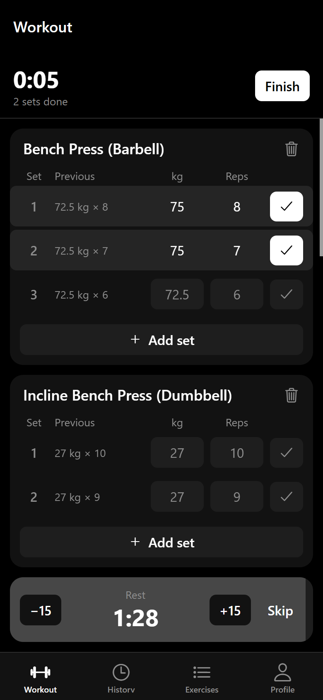
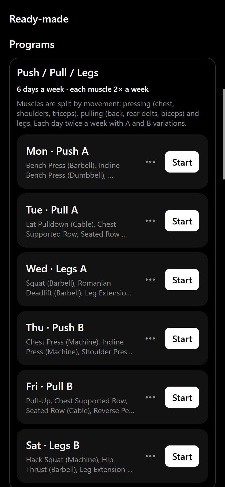
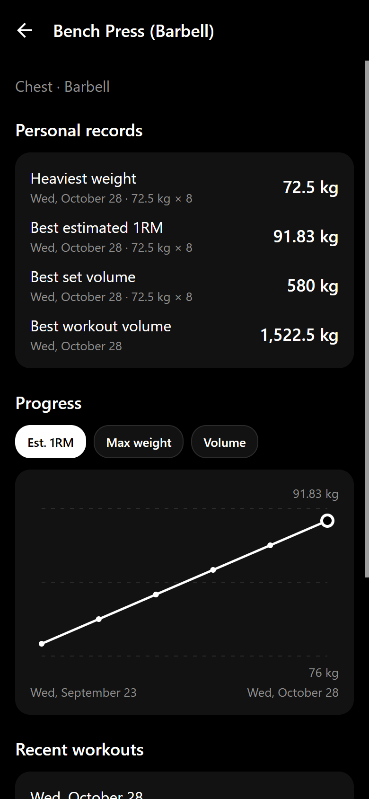
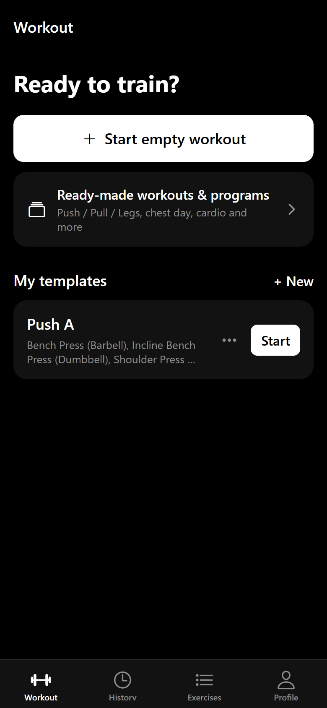
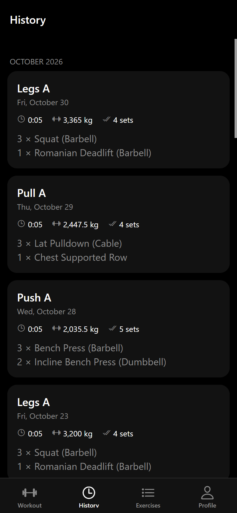
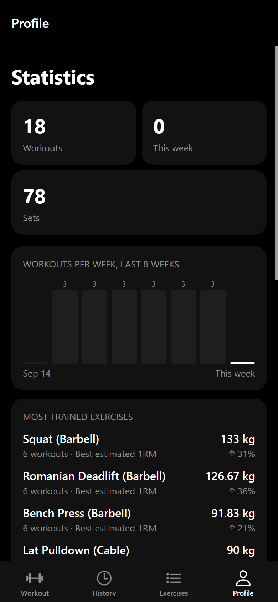

<p align="center">
  
</p>

<h1 align="center">Temir</h1>

<p align="center">
  A minimal, offline-first strength training tracker for iOS, Android and the web.<br />
  <i>Temir</i> means "iron" in Kazakh.
</p>

<p align="center">
  <a href="https://temir-pearl.vercel.app"><b>Live demo →</b></a><br />
  <sub>On iPhone: open in Safari → Share → <i>Add to Home Screen</i>. It runs fullscreen and works offline.</sub>
</p>

<p align="center">
  
  
  
</p>
<p align="center">
  
  
  
</p>

## Features

- **Workout logging** — weight × reps per set, the previous result for every set, rest timer with a
  notification, keeps the screen awake. An unfinished workout survives an app restart.
- **Cardio** — time (`25`, `25:30`, `1:05:00`) and optional distance.
- **Templates** — your own routines with planned sets and rep ranges (`6–8`), plus ready-made
  programs: Push/Pull/Legs, Upper/Lower, Bro Split, Full Body + Cardio, with a "which split to choose" guide.
- **Exercise library** — 84 built-in exercises, search, muscle group filters, custom exercises.
- **History and progress** — every workout in detail, personal records (max weight, estimated
  1RM by Epley, best set volume), charts per exercise, workouts per week.
- **Three languages** — Kazakh, English, Russian, switched instantly; plural forms, dates and numbers
  follow each language's rules.
- **kg / lb** — weights are stored in kg and converted only for display and input.
- **Offline-first** — no account, no server: all data lives in SQLite on the device.

## Tech stack

| Area | Choice |
| --- | --- |
| App | Expo SDK 58, React Native 0.88, React 19, TypeScript (strict) |
| Navigation | expo-router (file-based routes, typed routes) |
| Database | expo-sqlite + Drizzle ORM, generated migrations |
| State | Zustand (active workout, settings), persisted to SQLite key-value storage |
| i18n | i18next + react-i18next + expo-localization, typed translation keys |
| Charts | Small custom line/bar charts on react-native-svg |
| Tests | Jest (191 tests) |
| Web | react-native-web, installable PWA, hosted on Vercel |

## Architecture

```
src/
  app/            screens and layouts (expo-router)
  components/     small reusable UI components
  features/       feature UI and hooks: workout, routines, history, progress, exercises
  db/             Drizzle schema, client, migrations, seed data, repositories (all DB access)
  lib/            pure logic with unit tests: 1RM, volume, records, units, parsing, stats
  store/          Zustand stores
  i18n/, locales/ i18next setup and kk / en / ru translations
  theme/          colors, spacing, typography
```

Some decisions worth mentioning:

- **Logic is separate from UI.** Calculations live in `src/lib` as pure functions with unit tests;
  components only render. All database access goes through `src/db/repositories`.
- **Sync-ready data model.** UUID ids, `created_at` / `updated_at` on every table and soft deletes,
  so the data can later be synced to a backend without migrations of ids.
- **The active workout lives in memory** (Zustand, persisted) and is written to the database in one
  transaction when it is finished, so an abandoned workout never leaves half-saved rows.
- **Built-in exercises are stored as translation keys** with deterministic ids, so they are
  translated into every language and can be updated by a seed version without losing history.
- **The same code runs on the web.** SQLite runs as WebAssembly on the browser's private file system
  (needs cross-origin isolation headers, see `vercel.json`), native alerts are replaced by an in-app
  dialog, and a service worker caches the app for offline use.

## Getting started

Requirements: Node.js 20+, and the Expo Go app on a phone (or an emulator).

```bash
npm install
npx expo start          # scan the QR code with Expo Go
```

Other commands:

```bash
npm test                # unit tests
npm run typecheck       # TypeScript
npm run web:build       # web build into dist/
npm run web:serve       # serve dist/ locally with the production headers
npm run db:generate -- --name <change>   # new migration after a schema change
```

## Roadmap

- Accounts and cloud sync (Supabase)
- Data export / import
- App Store and Google Play release via EAS Build

## License

[MIT](LICENSE)
